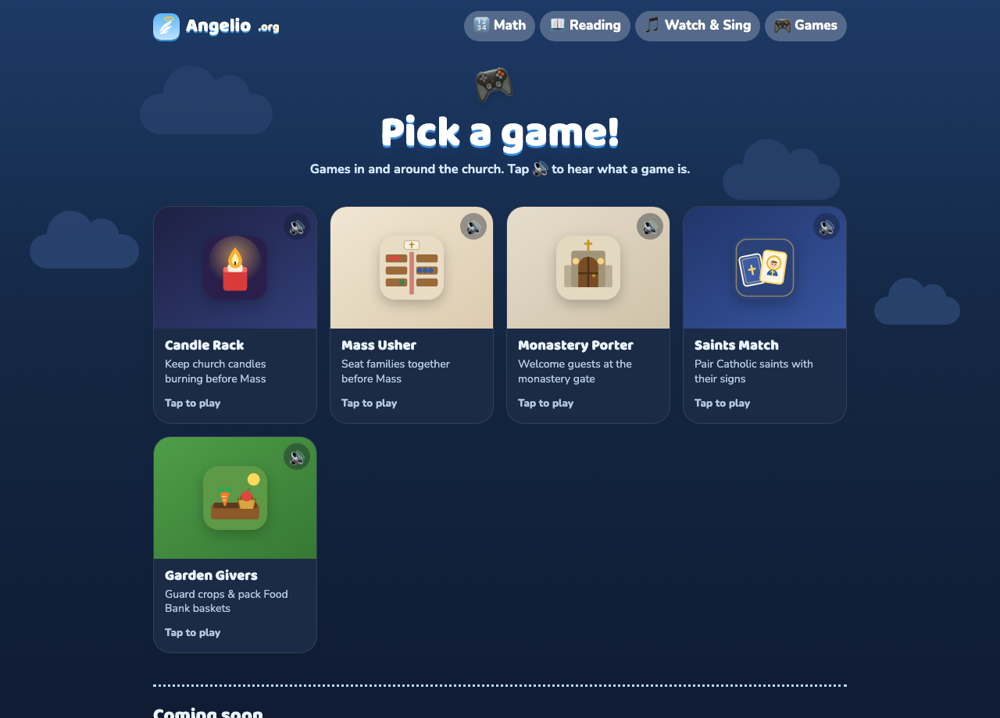

# Angelio

Free kids' learning games, church arcade games, video lessons, and songs at **[angelio.org](https://angelio.org)** — everything read aloud, offline-friendly, and in one monorepo.



## Repo Layout

| Folder | What lives here | Live URL |
|---|---|---|
| `hub/` | Home, `/games/`, `/stickers/` Sticker World, `/studio/`, `/admin/`, router | `angelio.org` |
| `apps/candles` | Candle Rack (church candles & Adoration) | `/candles/` |
| `apps/usher` | Mass Usher (seat families in pews) | `/usher/` |
| `apps/porter` | Monastery Porter (monastery gate) | `/porter/` |
| `apps/match` | Saints Match (saints & signs memory) | `/match/` |
| `apps/garden` | Garden Givers (monastery garden & Food Bank) | `/garden/` |
| `apps/snap`, `regroup`, `doubles`, `fractions` | Math apps (PreK–3) | `/snap/`, `/regroup/`, `/doubles/`, `/fractions/` |
| `apps/grammar`, `letters`, `read`, `articulate` | Reading, phonics & speech practice | `/grammar/`, `/letters/`, `/read/`, `/articulate/` |
| `apps/watch` | Watch & Sing (videos, quizzes, songs) | `/watch/` |
| `kit/` & `template/` | Master shared JS synced into apps + app starter | — |
| `docs/` | Concise handbook, screenshots (`docs/img/`), tech help & offline `help.html` | — |

Each app is a Cloudflare Worker (`wrangler.jsonc`).

```bash
npm install              # Once at repo root
npm test                 # Strict kit check + all 17 suites
npm run kit-sync         # Sync kit/ changes into apps (then bump sw.js VERSION)
npm run deploy -- watch  # Deploy one Worker (requires clean git)
```

## Docs & License
- **[Docs Index](docs/README.md)** · **[Games Handbook](docs/games-guide.md)** · **[Tech Help](docs/tech-help.md)** · **[Offline Search (`docs/help.html`)](docs/help.html)** · **[Roadmap](ROADMAP.md)**
- MIT, see [LICENSE](LICENSE) (name and logo reserved).
