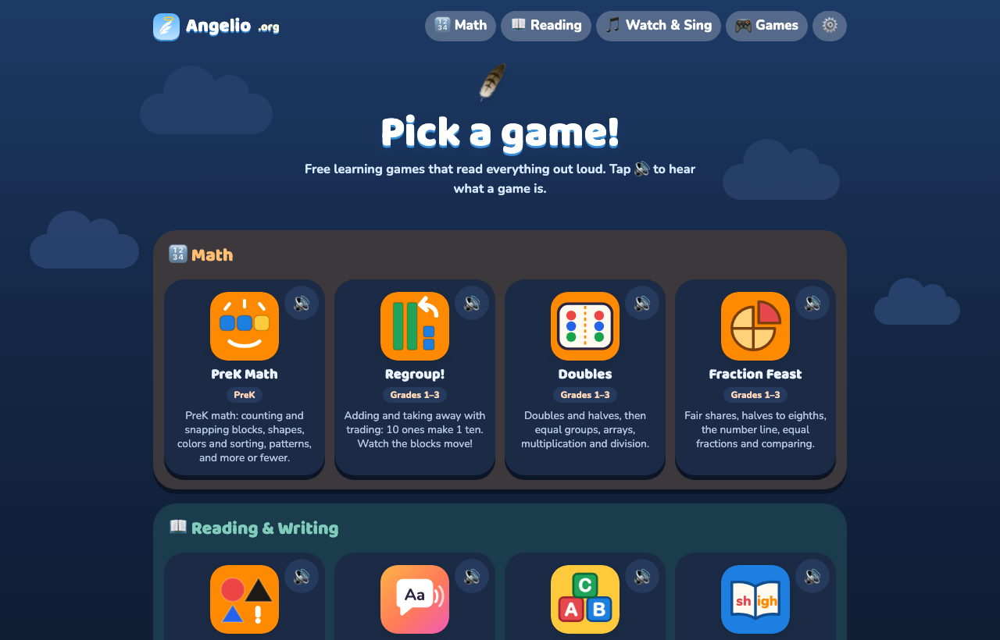

# Angelio Docs

Short, visual docs for **[angelio.org](https://angelio.org)** — what each part does, what it skips, and live screenshots.



## Guides
- **[Games & Apps Handbook](./games-guide.md)** — Rules, rewards (voxel vs 2D stickers), characters, and screenshots for all games.
- **[Tech Help & Fixes](./tech-help.md)** — Why `#/` URLs exist, Workers + `kit/`, voxel markers, and Symptom → Fix table.
- **[Searchable Help (`help.html`)](./help.html)** — Double-click to open an offline browser search across every topic and screenshot.
- **[Selling Family Codes](./selling-codes.md)** — Draft copy & Stripe checklist (paid speech checks on backburner).
- **[Roadmap](../ROADMAP.md)** — Active plans, voxel desk, and backlog.

## Repo Layout & Daily Commands

| Path | Purpose |
|---|---|
| [`hub/`](../hub/) | Main site, `/games/`, `/stickers/`, `/studio/`, `/admin/`, edge proxy |
| [`kit/`](../kit/) | Master shared JS (`npm run kit-sync` copies into apps — **never edit copies directly**) |
| [`apps/`](../apps/) | 5 arcade games + 9 learning apps (each its own Cloudflare Worker) |
| [`template/`](../template/) & [`tools/`](../tools/) | New-app starter, `deploy.mjs`, `vox-stickers.mjs` |

```bash
npm install                   # Once at repo root
npm test                      # Strict kit check + all 17 suites
npm run kit-sync              # Sync kit/ to apps (then bump sw.js VERSION)
git pull --rebase origin main # Pull nightly Studio backups before pushing
npm run deploy -- garden      # Deploy one Worker (requires clean git)
```
