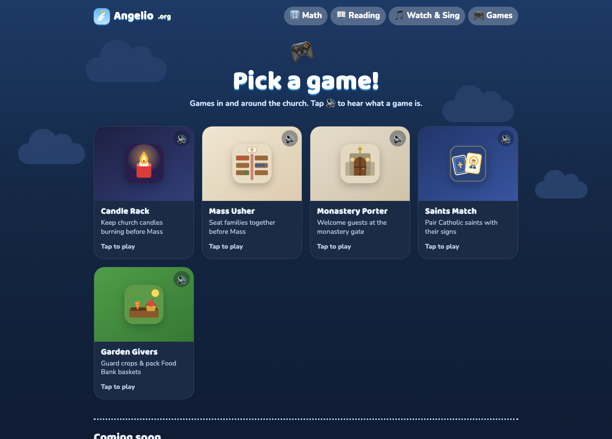
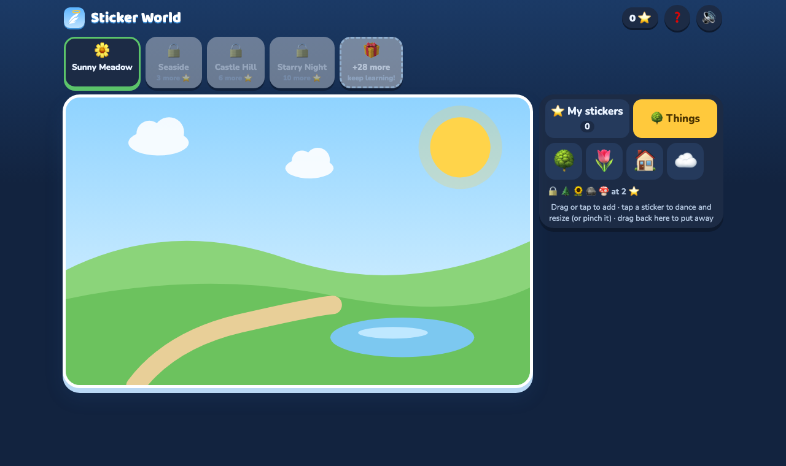
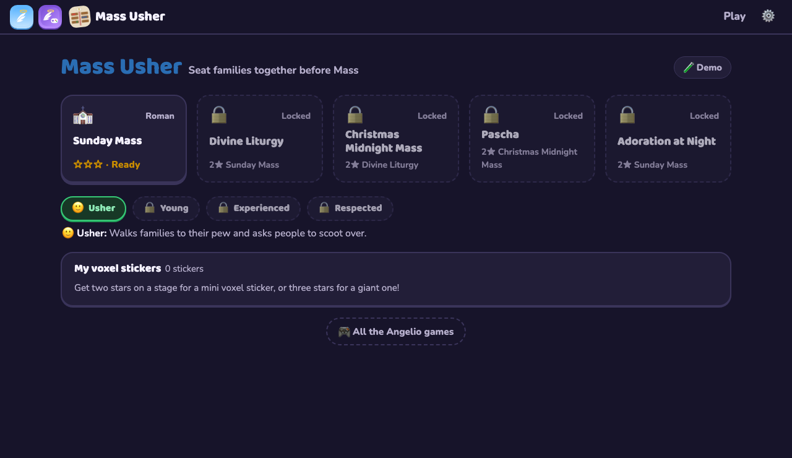
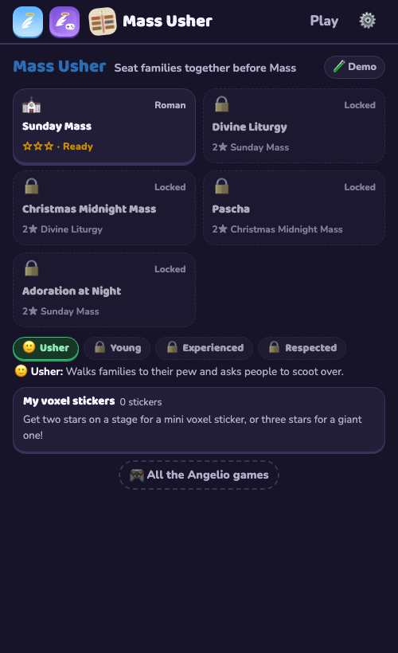
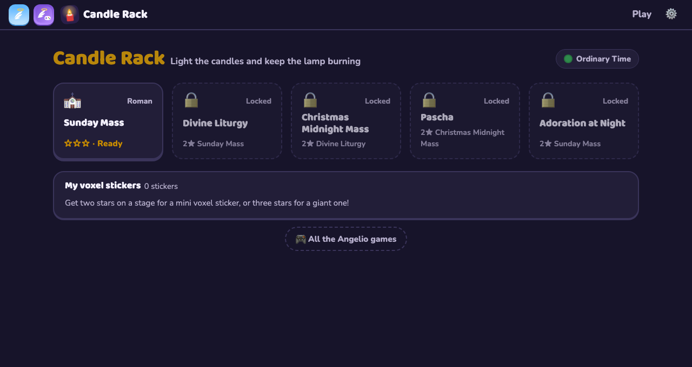
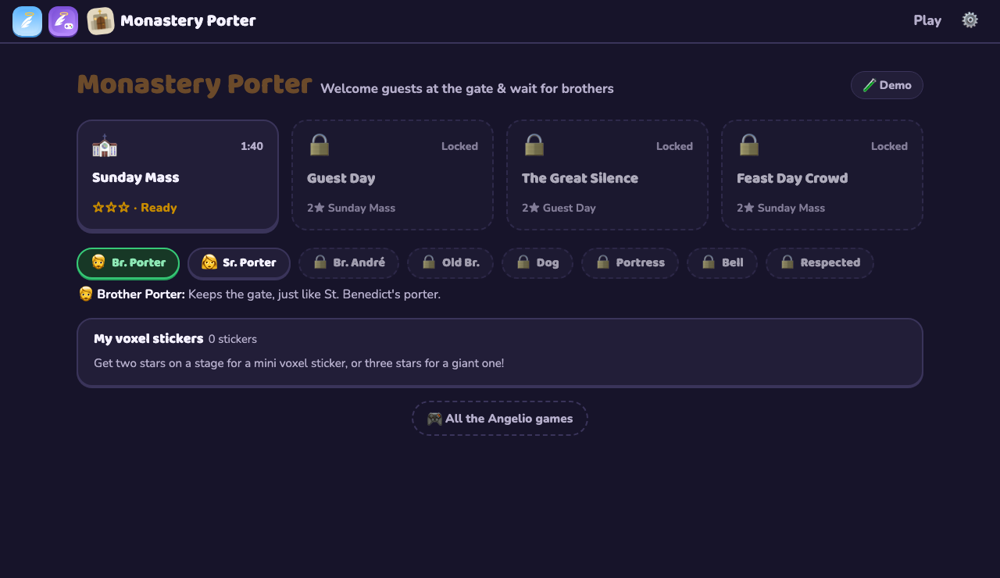
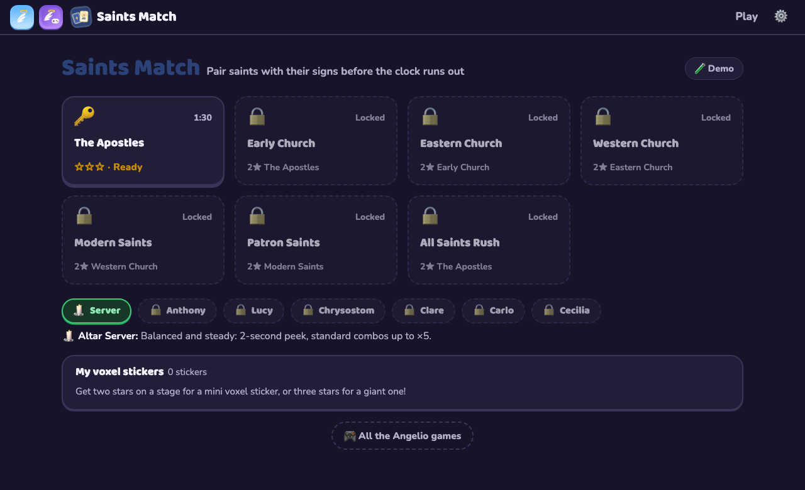
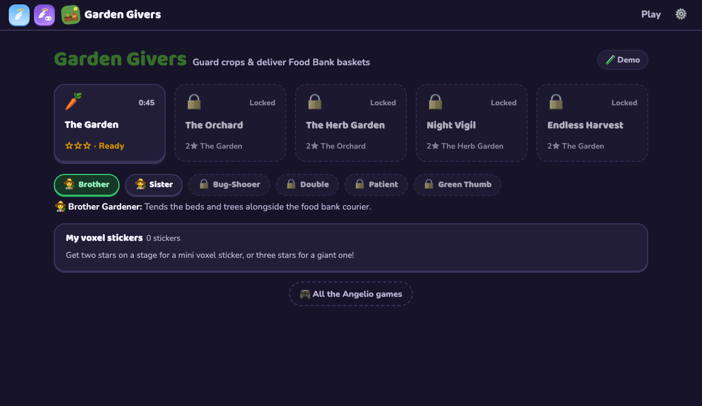

# Games & Apps Handbook

Fast visual reference for **[angelio.org/games/](https://angelio.org/games/)**.

---

## Stickers & Rewards (What You Win — and Don't)

| Group | Reward Type | 3★ | 2★ | 0–1★ |
|---|---|---|---|---|
| **5 Arcade Games** (`byStars: true`) | **Voxel characters (`vox:`)** — prefers unowned across 18 SVGs | **Giant sticker** (mistakes ignored) | **Mini sticker** | **No new sticker** |
| **9 Learning Apps** | **2D emoji & `art:` drawings** (no voxel stickers) | **Giant** at **0 mistakes** | **Mini** at **1+ mistakes** | Same rule (`mistakes` based) |

Shared saves live in browser `localStorage` (`angelio:stickers`) and load into **[Sticker World](/stickers/)**. Arcade sticker bars show total count (`My voxel stickers · N stickers`), never `"0 solved"`.

---

## Arcade Home Screen (Desktop & Mobile)

- **Uniform cards:** Every stage block (including dark-indigo **Endless**) shares the same card height; wide screens (`>= 1024px`) expand cleanly up to `1140px`.
- **Locked feedback without traps:** Tapping a locked character pill updates the perk line with its unlock rule **without** changing your active character; locked stages show requirements and stay unlaunchable.

---

## The 5 Arcade Games

### 1. Candle Rack (`/candles/`) — [`apps/candles/`](../apps/candles/)

- **Does:** Tap/swipe unlit or flickering (`< 25%`) candles (combos up to `×5`), oil the Sanctuary Lamp (`20–30 s`), relight your taper on stages 2+, and tap priest/server to light behind kneelers. Live spots edit at `/studio/candles/`.
- **Does not:** Has **no** character picker (uses active liturgical season chip instead).
- **Stages:** *Sunday Mass*, *Divine Liturgy*, *Christmas Midnight Mass*, *Pascha* (starts dark), *Adoration at Night* (Endless, 4 racks / 32 spots).

### 2. Mass Usher (`/usher/`) — [`apps/usher/`](../apps/usher/)
- **Does:** Tap a pew to walk and seat families (`10` pts seated, `4` pts back row, `+3`/person quick bonus `<= 8 s`); swipe a pew to scoot.
- **Does not:** `📌` stayers refuse to scoot unless playing **Respected Usher**.
- **Stages:** *Sunday Mass* (`150/370`), *Divine Liturgy* (`140/320`), *Christmas Midnight Mass* (`140/260`), *Pascha* (`100/240`), *Adoration at Night* (Endless, ends at `6` waiting families).
- **Ushers (4):** *Usher*, *Young* (`1.5×`, no scoot), *Experienced* (`0.7×`, auto-scoot), *Respected* (moves stayers).

### 3. Monastery Porter (`/porter/`) — [`apps/porter/`](../apps/porter/)

- **Does:** One choice per visitor — **Welcome** (`W`/`↑`/`Space`/tap gate) or **Send away** (`S`/`←`/`→`/swipe sideways), `B` rings Sr.'s bell. Wait when outgoing monks cross or lose your combo (`×5` max).
- **Does not:** Wrong answers cost `8` pts (unless *Br. André* forgives your first slip per minute).
- **Stages:** *Sunday Mass*, *Guest Day*, *The Great Silence*, *Feast Day Crowd* (Endless).
- **Porters (8):** *Br. Porter*, *Sr. Porter*, *Br. André*, *Old Br. Porter*, *Br. with Dog*, *Sr. Portress*, *Sr. with Bell*, *Respected Sr.*

### 4. Saints Match (`/match/`) — [`apps/match/`](../apps/match/)

- **Does:** `2 s` opening peek, match saint portraits & signs, trigger **Feast Rush** (`2×`) on Golden Halo pairs, and catch **Wind Swaps** (`Sharp Eye ⚡`).
- **Does not:** Per-card flip speech is **muted on purpose** so rapid flipping never stutters audio. Strict `3M / 3F` parity on every stage after *The Apostles*.
- **Stages:** *The Apostles* (`6M`), *Early Church*, *Eastern Church*, *Western Church*, *Modern Saints*, *Patron Saints*, *All Saints Rush* (Endless, `40 s` clock capped at `45 s`).
- **Patron Helpers (7):** *Altar Server* starter + *St. Anthony*, *St. Lucy*, *St. John Chrysostom*, *St. Clare*, *St. Carlo Acutis*, *St. Cecilia*.

### 5. Garden Givers (`/garden/`) — [`apps/garden/`](../apps/garden/)

- **Does:** **1 tap** shoos bugs/birds; **2 taps** shoo squirrels & raccoons. Harvest ripe beds, trees, and herbs matching Food Bank orders (up to `2` courier helpers walk baskets around solid tree trunks `r = 4.4`).
- **Does not:** Overdue orders tick negative; *Night Vigil* has **no picking or orders**.
- **Stages (0:45 + Endless):** *The Garden*, *The Orchard*, *The Herb Garden*, *Night Vigil* (all `1★` play, `250/425`), *Endless Harvest* (`500/1600`, ends at `10` eaten crops).
- **Gardeners (6):** *Brother* & *Sister* starters + *Bug-Shooer*, *Double Harvest*, *Patient*, *Green Thumb*.

---

## Learning Apps, Studio & Voxel Markers

| App | Path | Focus | Studio / Admin | Path |
|---|---|---|---|---|
| **PreK Math** | `/snap/` | Counting & sorting | **Watch & Sing CMS** | `/studio/` |
| **Regroup!** | `/regroup/` | Carry & borrow (1–3) | **Reading Lessons** | `/studio/reading.html` |
| **Doubles** | `/doubles/` | Mental math doubles (1–3) | **Voxel Drawings** | `/studio/draw/` |
| **Fraction Feast** | `/fractions/` | Fractions on food plates | **Candle Rack Spots** | `/studio/candles/` |
| **Grammar!** | `/grammar/` | Sentences & parts of speech | **Family Codes** | `/admin/` |
| **Letter Lane** | `/letters/` | Phonics (PreK–K) | **Sounds / Voices** | `/admin/sounds.html`, `/admin/voices.html` |
| **Read Aloud** | `/read/` | Reading practice (1–3) | **Lead Sheets** | `/admin/leadsheet` |
| **Watch & Sing** | `/watch/` | Video lessons, songs, quizzes | | |
| **Articulate** | `/articulate/` | Speech practice (outside `kit/`) | | |

**MagicaVoxel markers (`looks.js`):** Paint Hair `#255359`, Eyes `#0066ff`/`#0b346e`, Skin `#cccc99`/`#fad689`, Shirt `#ffcc99`, Dress `#ff9966`, Belt `#ff9999`, Shoes `#ffcccc`, Roman Chasuble `#ff77a8`, Byzantine Phelonion `#ffcc66`. Use these hexes **only** for recolorable parts; unuploaded `.vox` slugs show box stand-ins, and missing `-idle` files hold walkers at frame `0`.
